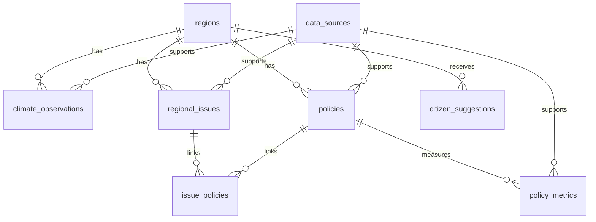

# 우리동네 기후·정책 (Local Climate Policy)

지역의 기후변화 지표, 생활권 문제, 지방자치단체 정책을 한곳에서 확인하고 정책 관련 지표를 비교하기 위한 웹 애플리케이션입니다. 현재 저장소에는 HTML/CSS/JavaScript 프런트엔드와 FastAPI 백엔드 골격, MySQL 스키마가 포함되어 있습니다.

> **데이터 주의:** 현재 프런트엔드의 기후 수치, 지도 마커, 정책 카드 및 정책 효과 값은 화면 시연용 예시입니다. 실제 관측값·위험도·정책 현황·정책 성과로 인용하지 마세요. 공식 자료 연동과 검증은 별도 구현·확인이 필요합니다.

## 1. 기능정의서

| ID | 기능 | 주요 입력·처리 | 결과 및 검수 기준 |
|---|---|---|---|
| F-01 | 메인 대시보드 | 지역 선택, 기후·문제·정책 요약 조회 | 지역별 요약과 화면 이동 제공 |
| F-02 | 지역 기후 분석 | 지역, 기후 지표, 기간 선택 | 연도별 그래프 표시; 단위·기간·출처 확인 |
| F-03 | 지역문제 지도 | 문제 유형 필터, 지도 마커 선택 | 문제 위치와 상세 화면 연결; 위치는 공식 자료로 검증 |
| F-04 | 지역문제 상세 | 문제 설명, 지표, 자료 출처 확인 | 확인된 사실과 분석 가설 구분 |
| F-05 | 지역정책 탐색 | 정책 키워드, 분야, 지역 검색 | 담당기관·기간·상태·공식 URL 확인 |
| F-06 | 정책 효과 비교 | 정책, 지표, 시행 전후 기간 선택 | 비교값·단위·기간 표시; 차이만으로 인과효과를 단정하지 않음 |
| F-07 | 시민참여 | 지역, 유형, 장소, 제안 내용 입력 | 입력값 검증 및 접수 상태 표시; 공개 전 개인정보 검토 |
| F-08 | 데이터 출처·품질 관리 | 출처 URL, 수집일, 단위, 기준일, 검증 상태 관리 | 원자료 추적과 미검증 자료 식별 |
| F-09 | API 제공 | FastAPI 엔드포인트 요청 | 프런트엔드용 JSON 응답 |
| F-10 | AI 기사 초안 | 주제, 지역, Fact Sheet, 원자료 URL | `/api/news/draft`로 OpenAI 초안 생성; 자동 게시하지 않고 원자료 대조·사람 승인 필요 |

### 업무·검증 원칙
- 출처·기준일·단위가 확인되지 않은 값은 검증 완료 자료처럼 표시하지 않습니다.
- 결측값을 0으로 대체하지 않고, 누락·중복·이상값을 별도로 표시합니다.
- 서로 다른 지역 단위·관측 지점·기간의 자료를 직접 비교하지 않습니다.
- 정책 전후 차이는 참고 지표이며, 다른 요인을 검토하지 않고 정책의 인과적 효과라고 단정하지 않습니다.
- 시민 제안은 필요한 정보만 수집하고, 공개 전 개인정보와 게시 적합성을 확인합니다.

## 2. 화면구성도·화면설계

### 화면 흐름

```text
메인 대시보드
├── 지역 기후 분석
│   └── 지역·지표·기간 선택 → 그래프·출처 확인
├── 지역문제 지도
│   └── 문제 유형 선택 → 문제 상세 → 관련 정책
├── 지역정책 탐색
│   └── 키워드·분야·지역 필터 → 정책 정보
├── 정책 효과 비교
│   └── 정책·지표 선택 → 시행 전후 값 비교
└── 시민참여
    └── 제안 입력 → 검증 → 접수 상태
```

### 화면별 설계

| 화면 | 주요 구성 요소 | 사용자 동작 | 확인 사항 |
|---|---|---|---|
| 1. 홈 | 지역 선택, 기후 요약, 주요 이슈, 정책 카드 | 각 기능으로 이동 | 요약 데이터의 기준일·출처 |
| 2. 지역 기후 | 지역·지표·기간 필터, 그래프, 출처 링크 | 조건 변경 및 추이 확인 | 단위, 기간, 관측소, 결측치 |
| 3. 지역문제 지도 | 지도, 문제 유형 필터, 문제 목록 | 마커·목록 선택 | 좌표와 위험 정보의 공식 출처 |
| 4. 문제 상세 | 현황, 관련 지표, 근거 자료, 관련 정책 | 근거 및 정책 확인 | 사실과 가설 구분 |
| 5. 지역정책 | 검색, 분야·지역 필터, 정책 카드 | 정책 탐색 | 담당기관, 시행 상태, 공식 URL |
| 6. 정책 효과 비교 | 정책·지표 선택, 전후 값·기간 | 비교 결과 확인 | 단위와 비교 기간 일치 여부 |
| 7. 시민참여 | 지역·유형·장소·내용 입력, 공개 여부 | 제안 제출 | 필수값·개인정보·공개 승인 |\n| 8. AI 기사 제작 | 주제·독자·형식, Fact Sheet, 원자료 URL, 초안·검수 체크리스트 | 초안 생성, 원자료 대조, 사람 검수·승인 상태 관리 | AI 초안과 실제 게시를 구분; 현재 임시 저장은 브라우저 로컬에만 보관 |

공통 UI 원칙: 로딩·오류·빈 결과·검증 대기 상태를 구분하고, 데이터 화면에서 출처와 기준일을 쉽게 확인할 수 있도록 합니다. 좁은 화면에서도 사용할 수 있도록 반응형 레이아웃을 유지합니다.

## 3. DB 설계

- **DBMS:** MySQL
- **데이터베이스:** `local_climate_policy`
- **스키마 파일:** `database/schema.sql`
- **PK:** 각 테이블 레코드의 고유 식별자
- **FK:** 지역·출처·문제·정책 간 관계를 연결

### ERD 개요



### 테이블 정의

| 테이블 | PK | 주요 컬럼·관계 | 목적 |
|---|---|---|---|
| `regions` | `region_id` | `region_code`, `parent_region_id`, `region_name`, `region_level` | 지역 및 상하위 지역 구조 |
| `data_sources` | `source_id` | `source_name`, `source_url`, `license_note`, `checked_at` | 원자료 출처·이용 조건 관리 |
| `climate_observations` | `observation_id` | `region_id` FK, `source_id` FK, `station_code`, `metric_code`, `observation_date`, `metric_value`, `unit`, `quality_flag` | 기후 관측값 |
| `regional_issues` | `issue_id` | `region_id` FK, `source_id` FK, 제목·유형·기준일·좌표·검증 상태 | 지역문제 정보 |
| `policies` | `policy_id` | `region_id` FK, `source_id` FK, 정책명·담당기관·상태·기간·예산·공식 URL | 지역정책 정보 |
| `issue_policies` | `issue_id` + `policy_id` | 두 컬럼 모두 FK | 문제와 정책의 다대다 관계 |
| `policy_metrics` | `policy_metric_id` | `policy_id` FK, `source_id` FK, 지표명·전후 값·단위·비교 기간 | 정책 관련 지표 비교 |
| `citizen_suggestions` | `suggestion_id` | `region_id` FK, 유형·장소·내용·상태·공개 여부 | 시민 제안 접수·관리 |

### 주요 제약조건
- `regions.region_code`는 중복 방지를 위해 UNIQUE로 관리합니다.
- 관측 자료는 지역·지표·날짜 조합을 고려해 조회 인덱스를 설정합니다.
- `issue_policies`는 두 FK를 복합 PK로 사용해 같은 관계의 중복 등록을 막습니다.
- 관측값·정책 지표에는 단위와 기준 기간을 함께 저장합니다.
- 실제 운영 전 날짜 범위, 허용 상태값, 입력값, 권한 및 개인정보 처리 규칙을 추가 검증합니다.

## 4. 데이터 수집 방법

자료는 공식 출처를 우선으로 하며, CSV 다운로드·Open API·PDF 문서 방식으로 수집할 수 있습니다.

| 방식 | 대상 예시 | 수집 절차 | 유의 사항 |
|---|---|---|---|
| CSV 다운로드 | 기온·강수량·폭염일수·지역 통계 | 공식 사이트에서 다운로드 → Python으로 읽기 → 정제·저장 | 인코딩, 날짜 형식, 결측치, 단위 확인 |
| Open API | 기상 관측·공공데이터·지역 통계 | 이용 신청 및 인증키 발급 → HTTP 요청 → JSON 파싱 → 정제·저장 | 인증키 보호, 호출 한도, 오류 응답 확인 |
| PDF 문서 | 지자체 기후계획·정책 보고서·사업계획 | 공식 PDF 확보 → 텍스트·표 추출 → 원문 페이지와 대조 | 표 추출 오류와 문맥 누락을 원문으로 검증 |

### 권장 공식 출처
- 기상자료개방포털: https://data.kma.go.kr/
- 공공데이터포털: https://www.data.go.kr/
- 국가통계포털(KOSIS): https://kosis.kr/
- 지자체 공식 홈페이지, 기후대응계획, 정책 공고 및 사업계획서

### 수집 및 검증 절차
1. 출처의 공식성, 이용 조건, 갱신 주기와 API 호출 조건을 확인합니다.
2. 원본 URL·수집 일시·자료 기준일을 기록합니다.
3. Python으로 지역 코드, 날짜, 단위, 결측·중복값을 정리합니다.
4. 원자료와 대조하고 검증 상태를 표시합니다.
5. 검증된 자료만 분석·화면 표시·기사 초안 작성에 사용합니다.

### AI 기사 작성 시 근거 확인
```text
주제 선정
 → CSV / Open API / PDF 원자료 수집
 → Fact Sheet(핵심 사실·수치·출처) 검증
 → OpenAI API로 기사 초안 생성
 → 주장·수치를 원자료와 대조하고 수정
 → 사람의 최종 검토·승인
 → 게시
```

LLM이 만든 문장을 사실로 간주하지 않습니다. 원자료로 확인할 수 없는 주장은 삭제하거나 미확인으로 표시하며, 자동 게시 대신 사람의 최종 승인을 거칩니다.

## 5. 개발 환경

| 항목 | 기술 | 용도 |
|---|---|---|
| 운영체제 | Windows 11 | 로컬 개발 |
| 개발 도구 | Visual Studio Code | 코드 편집·터미널·디버깅 |
| 언어 | Python | 데이터 수집·정제·검증 및 백엔드 |
| 백엔드 | FastAPI, Uvicorn | REST API 제공 |
| 데이터베이스 | MySQL | 기후·지역문제·정책·출처·시민 제안 저장 |
| LLM | OpenAI API | 근거 자료 기반 뉴스 기사 초안 생성 |
| 프런트엔드 | HTML, CSS, JavaScript | 사용자 화면과 상호작용 |
| 시각화·지도 | Chart.js, Leaflet | 그래프 및 지도 표시 |
| 설정 관리 | `.env` | API 키와 DB 접속 정보 관리 |

현재 프런트엔드는 HTML/CSS/JavaScript 기반이며, FastAPI에는 입력된 Fact Sheet를 바탕으로 OpenAI 기사 초안을 만드는 `/api/news/draft` 엔드포인트가 있습니다. 다만 공식 원자료 URL을 자동으로 열어 본문을 검증하지 않으며, 기사 생성 결과는 초안입니다. 기후·정책 데이터의 실제 DB 조회, 시민 제안 DB 저장, 기사·검수 이력의 서버 저장 및 실제 게시 기능은 아직 완성되지 않았습니다.

### 환경변수 예시

```dotenv
OPENAI_API_KEY=발급받은_API_키
OPENAI_MODEL=gpt-4.1-mini
KMA_SERVICE_KEY=공공데이터포털_기상청_ASOS_API_일반인증키
DB_HOST=127.0.0.1
DB_PORT=3306
DB_NAME=local_climate_policy
DB_USER=사용자명
DB_PASSWORD=비밀번호
```

실제 변수명은 백엔드 구현과 일치시켜야 합니다. `.env`는 GitHub에 올리지 말고, `.env.example`에는 비밀값이 아닌 변수명과 예시만 기록합니다. 사용 가능한 OpenAI 모델명과 계정 접근 권한은 실행 시점의 API 문서에서 확인합니다.

## 6. 실행 방법

### 준비
- Git과 VS Code 설치
- Python 3.12 권장(설치된 버전은 `py --list`로 확인)
- MySQL Server 설치 및 실행
- 선택 기능 사용 시 OpenAI API 키 준비

### 6.1 저장소 내려받기

VS Code 터미널 또는 PowerShell에서 실행합니다.

```powershell
git clone https://github.com/sinyoungk0711-droid/local-climate-policy.git
cd local-climate-policy
code .
```

### 6.2 프런트엔드 실행

**권장 방법: Python 내장 웹 서버**를 사용합니다. 프로젝트 루트 폴더에서 새 터미널을 열고 실행합니다.

```powershell
py -m http.server 5500 --directory frontend
```

브라우저에서 **http://127.0.0.1:5500/** 을 엽니다. 이 방법은 HTML 파일을 직접 `file://`로 여는 것보다 경로와 브라우저 보안 동작을 일관되게 확인하기 쉽습니다.

- 다른 방법: VS Code의 Live Server 확장으로 `frontend/index.html`을 실행해도 됩니다.
- 이 프로토타입의 화면 탐색, 지역 선택, 정책 검색·필터, 지도, 그래프, 시민 제안 미리보기, 기사 작성 체크리스트는 프런트엔드에서 시연할 수 있습니다.
- 지도 타일과 Chart.js·Leaflet 라이브러리는 CDN을 사용하므로 인터넷 연결이 필요합니다. 라이브러리 로딩이 실패하면 그래프에는 안내 문구가 표시됩니다.
- 프런트엔드 서버 종료: 해당 터미널에서 `Ctrl+C`.

**AI 기사 생성은 별도 백엔드 실행이 필요합니다.** 아래 6.3의 FastAPI 서버를 두 번째 터미널에서 실행하고, 서버의 `.env`에 유효한 `OPENAI_API_KEY`를 설정해야 합니다. 프런트엔드의 기사 생성 기능은 `http://127.0.0.1:8000/api/news/draft`를 호출합니다.


### 브라우저에서 확인할 기능

1. **홈:** 지역 선택과 각 기능 화면으로 이동
2. **지역기후:** 기후 지표·기간 변경 및 예시 그래프 표시
3. **지역문제:** 문제 유형 필터, 지도 마커 선택, 상세 화면 이동
4. **지역정책:** 키워드·분야·지역 필터. 현재 정책 카드는 지역별 검증 자료가 없는 예시이므로 특정 지역을 선택하면 결과가 없을 수 있습니다.
5. **정책 효과 비교:** 지표 선택 및 예시 수치 비교
6. **AI 기사 제작:** Fact Sheet와 출처 URL 입력, 확인 체크, AI 초안 요청, 원자료 대조 체크리스트, 사람 검수·승인 표시, 검수 기록 JSON 다운로드
7. **시민참여:** 입력값 검증 및 브라우저 내 미리보기

> **데이터·저장 범위:** 그래프와 정책 효과 값, 지도 마커는 화면 기능 확인용 예시입니다. Fact Sheet 확인 체크는 자동 팩트체크를 의미하지 않습니다. 시민 제안은 현재 서버 DB에 저장되지 않으며, 승인 버튼도 외부 사이트에 기사를 게시하지 않습니다. 브라우저 임시 저장은 해당 브라우저에만 남습니다.

### 6.3 FastAPI 실행

프로젝트 루트에서 실행합니다.

```powershell
py -3.12 -m venv .venv
.\.venv\Scripts\Activate.ps1
python -m pip install --upgrade pip
pip install -r backend/requirements.txt
uvicorn backend.app.main:app --reload
```

- API 서버: http://127.0.0.1:8000
- API 문서: http://127.0.0.1:8000/docs
- 종료: 터미널에서 `Ctrl+C`

Python 3.12가 설치되어 있지 않으면 `py --list`로 사용 가능한 버전을 확인하고 호환되는 버전을 사용합니다. PowerShell에서 가상환경 활성화가 제한되면 터미널 정책을 확인하거나 명령 프롬프트에서 `.venv\Scripts\activate.bat`를 실행합니다.

### 6.4 MySQL 설정

1. MySQL 서버를 실행합니다.
2. MySQL 클라이언트에서 `database/schema.sql`을 실행합니다.
3. `.env.example`을 참고해 프로젝트 루트에 `.env`를 만듭니다.
4. DB 접속 정보가 실제 백엔드 코드에서 읽히는지 확인합니다.

현재 백엔드는 MySQL 연결, 기상청 ASOS 일자료 수집(`/api/climate/collect`), 연도별 조회(`/api/climate`), 저장된 관측값 기반 Fact Sheet 생성(`/api/news/facts`)을 제공합니다. 실행하려면 MySQL과 공공데이터포털 API 키를 먼저 설정해야 합니다.

### 6.5 OpenAI API 설정

1. OpenAI 플랫폼에서 API 키를 발급하고 계정의 사용량·결제 설정을 확인합니다.
2. `.env`에 `OPENAI_API_KEY`와 사용할 모델명을 설정합니다.
3. 백엔드에서 환경변수를 읽고 API 호출을 수행하도록 구현·테스트합니다.
4. 기사 초안은 원자료와 대조하고 사람의 승인을 받은 뒤 사용합니다.

### 실행 점검
- 프런트엔드가 표시되지 않으면 파일 경로와 Live Server 주소를 확인합니다.
- FastAPI 오류는 가상환경, 의존성 설치, 터미널 오류 메시지를 확인합니다.
- `/docs`가 열리지 않으면 서버 실행 여부와 포트 충돌을 확인합니다.
- MySQL 오류는 서버 상태, 계정 권한, 포트, DB 이름과 환경변수를 확인합니다.
- 지도·외부 라이브러리는 인터넷 연결 상태를 확인합니다.
- 실제 운영 전에는 인증·권한·입력 검증·오류 처리·로그·개인정보 보호를 추가 점검합니다.

## 프로젝트 구조

```text
local-climate-policy/
├── frontend/
│   ├── index.html
│   ├── css/styles.css
│   └── js/app.js
├── backend/
│   ├── app/main.py
│   ├── app/climate_data.py
│   └── requirements.txt
├── database/
│   └── schema.sql
├── .env.example
└── README.md
```

## 개발 상태 및 다음 단계

1. 로컬 환경에서 MySQL과 기상청 API 키를 설정하고 실제 수집을 실행합니다.
2. 그래프에 저장된 값이 표시되는지 확인하고, 자료의 기간·단위·결측·관측소 대표성을 검수합니다.
3. AI 기사 화면에서 MySQL 자료로 Fact Sheet를 만들고 확인된 사실을 원자료와 대조합니다.
4. OpenAI API 키를 설정해 기사 초안을 생성한 뒤 사람의 최종 검수를 수행합니다.
5. 실제 게시 기능은 별도 구현이며, 공개 전 API 인증·호출 제한·로그·데이터 품질을 점검합니다.


## 공식 기후자료 수집 및 MySQL 연결

1. 공공데이터포털에서 기상청 ASOS 일자료 조회서비스를 신청하고 서비스 키를 발급받습니다.
2. `.env`에 `KMA_SERVICE_KEY`와 MySQL 접속 정보를 설정하고 `database/schema.sql`을 실행합니다.
3. FastAPI를 실행한 뒤 `http://127.0.0.1:8000/docs`에서 `POST /api/climate/collect`를 실행합니다. `start_date=20240101`, `end_date=20241231`, `region_code=11`을 예시로 사용할 수 있습니다. 지역 코드를 생략하면 등록된 6개 관측소를 수집합니다.
4. 프런트엔드 기후 분석 화면은 `GET /api/climate`에서 MySQL의 연도별 자료를 조회합니다. 데이터가 없으면 안내문을 표시하며 예시값으로 대체하지 않습니다.
5. AI 기사 화면의 ‘MySQL 기후자료로 Fact Sheet 만들기’ 버튼으로 저장된 연도별 관측값을 불러올 수 있습니다. 이 기능은 수집된 값을 바탕으로 사실표를 만들며, 출처·기간·단위·관측소 대표성은 사람이 확인한 뒤 체크해야 합니다.
6. 지표 정의: 평균기온은 일평균기온의 연평균, 강수량은 일강수량의 연합계, 폭염일수는 일최고기온 33°C 이상인 날, 열대야일수는 일최저기온 25°C 이상인 날입니다. 결측일은 0으로 채우지 않습니다.

자료 출처: https://data.kma.go.kr/ 및 https://www.data.go.kr/. 광역지역은 대표 관측소 한 곳의 값이며 지역 전체 공간평균은 아닙니다. 기사에 사용하기 전 관측소·기간·단위·결측 여부를 사람이 확인해야 합니다. 수집 API는 로컬 개발용이므로 공개 배포 전 인증·호출 제한을 추가하세요.


## 회원가입 및 로그인

- 회원가입 API: `POST /api/auth/register`
- 로그인 API: `POST /api/auth/login`
- 현재 사용자 조회: `GET /api/auth/me` (Bearer 토큰 필요)
- 로그아웃: 브라우저 세션 토큰 삭제 후 `POST /api/auth/logout`
- 이메일 중복을 검사하고 비밀번호는 Python `hashlib.scrypt`로 해시하여 MySQL에 저장합니다.
- 로그인 토큰은 12시간 유효한 HMAC-SHA256 서명 토큰이며 브라우저 `sessionStorage`에 보관됩니다. 서버 재시작이나 로그아웃으로 토큰 자체를 폐기하는 방식은 아니며, 브라우저가 토큰을 삭제합니다.
- 처음 DB를 만들 때는 `database/schema.sql`을 실행합니다. 기존 DB를 유지하면서 인증만 추가한다면 `database/migrations/001_auth.sql`만 실행하세요.
- `.env`에 최소 32자 이상의 임의 `AUTH_SECRET_KEY`를 추가하세요. 예: `py -c "import secrets; print(secrets.token_urlsafe(48))"`. 실제 키는 GitHub에 올리지 마세요.
- 인증 UI/API는 기본 기능을 제공하는 개발용 구현입니다. 공개 배포 전에는 HTTPS, 로그인 시도 제한, 이메일 인증·비밀번호 재설정, CSRF/XSS 검토, 보안 로그 및 개인정보 처리 안내를 추가하세요. 기존 지역기후/정책 화면은 공개 상태이며, 회원 인증만으로 기능 접근이 제한되지는 않습니다.


## 공식 기후자료 수집·저장 구현 상태 (2026-10-20)

기존 수집 API를 중복 생성하지 않고 `POST /api/climate/collect`와 `GET /api/climate`를 유지했습니다.

- 공식 출처: 기상청 기상자료개방포털 ASOS 일자료 API
- 수집 API: `POST /api/climate/collect?start_date=20240101&end_date=20241231&region_code=11`
- 재수집: 동일한 지역·관측소·지표·관측일·주기의 UNIQUE 키와 `ON DUPLICATE KEY UPDATE`로 기존 관측값을 갱신합니다.
- 출처: `data_sources`에 출처명과 URL을 저장합니다.
- 수집 시각: `climate_observations.collected_at`에 저장합니다.
- 결측: 결측·비수치 값은 저장하지 않고 0으로 채우지 않으며, API 응답의 `missing_values_skipped`에 건수를 표시합니다.
- 오류 로그: `collection_logs`에 성공/실패 상태, 요청 기간, 지역, 시작·종료 시각, 처리 건수 및 오류 메시지를 저장합니다. 서버 로그에도 예외를 기록합니다.

### 데이터베이스 설정 / 기존 DB 업그레이드

저장소에 기존 문서에서 참조하던 `database/schema.sql`이 없고 `database/schema.spl`만 있던 문제를 보완했습니다. `database/schema.sql`은 현재 FastAPI 코드와 호환되는 정식 스키마이며, `regions`, `data_sources`, `climate_observations`, `collection_logs`, `users`를 생성합니다. 기존 호환 테이블은 `CREATE TABLE IF NOT EXISTS`로 보존합니다.

- 새 DB 또는 개발용 DB: MySQL Workbench에서 `database/schema.sql` 실행
- 기존 DB: 먼저 백업하고 테이블/컬럼/인덱스를 확인하세요. `database/migrations/002_climate_collection_logs.sql`은 수집 로그 테이블을 추가합니다. 기존 `climate_observations`에 `collected_at`이 없다면 마이그레이션 주석의 ALTER 문을 확인 후 실행하세요. 기존 중복 자료가 있으면 UNIQUE 인덱스를 추가하기 전에 중복을 정리해야 합니다.
- `database/schema.spl`은 예전 초안이므로 새 실행 안내에서는 `database/schema.sql`을 사용합니다.

### 수집 실행

1. `.env`에 `KMA_SERVICE_KEY`, `DB_HOST`, `DB_PORT`, `DB_NAME`, `DB_USER`, `DB_PASSWORD`를 설정합니다.
2. `uvicorn backend.app.main:app --reload`로 API를 실행합니다.
3. `http://127.0.0.1:8000/docs`에서 `POST /api/climate/collect`를 실행하거나 PowerShell에서 호출합니다.

```powershell
$body = "start_date=20240101&end_date=20241231&region_code=11"
Invoke-RestMethod -Method Post -Uri ("http://127.0.0.1:8000/api/climate/collect?" + $body)
```

같은 기간을 다시 수집해도 고유키에 맞는 기존 관측값을 갱신합니다. 실제 실행 결과는 공공데이터포털 인증키, MySQL 서버와 스키마 설정에 따라 달라집니다.


## 단계별 구현: CRUD → OpenWeather/Fact Sheet → 기사 검수

### 1차 — FastAPI + MySQL CRUD
- 기존 기후 자료 API 유지: `GET /api/climate`, `POST /api/climate/collect`
- 기사 CRUD: `POST/GET /api/news/articles`, `GET/PUT/DELETE /api/news/articles/{article_id}`
- 기사 수정 시 검수 상태를 `pending`으로 되돌립니다.
- 지역/기간별 Fact Sheet: `GET /api/news/facts?region_code=11&year=2024`

### 2차 — OpenWeather 수집
- `POST /api/weather/collect?region_code=11`: 현재 날씨를 OpenWeather에서 가져와 MySQL에 저장합니다.
- `GET /api/weather?region_code=11&limit=50`: 저장된 날씨 스냅샷을 조회합니다.
- 지원 지역 코드는 `11` 서울, `26` 부산, `27` 대구, `29` 광주, `30` 대전, `50` 제주입니다.
- `OPENWEATHER_API_KEY`를 `.env`에 설정하고 `database/migrations/003_weather_news_workflow.sql`을 실행해야 합니다.
- OpenWeather 자료는 도시 중심 좌표의 현재 날씨 스냅샷입니다. 시·도 전체 평균이나 장기 기후 관측값으로 해석하지 마세요. 강수량은 API 응답에 1시간 강수량이 있을 때만 저장합니다.

### 3차 — 기사 검수 상태
- 기사 저장 시 기본 상태는 `pending`입니다.
- `PATCH /api/news/articles/{article_id}/review`로 상태를 `approved` 또는 `on_hold`로 변경할 수 있습니다.
- 검수 요청 JSON 예시:

```json
{
  "status": "approved",
  "reviewer": "편집자",
  "review_note": "원자료의 수치와 기준 기간을 대조했습니다."
}
```

- 상태별 목록: `GET /api/news/articles?status=pending`, `approved`, `on_hold`
- 검수 이력은 `news_reviews`에 별도 저장합니다.
- 승인 상태는 편집 승인 표시일 뿐, 자동 게시 기능을 실행하지 않습니다.

### 마이그레이션과 로컬 테스트

1. 기존 DB를 백업한 뒤 MySQL Workbench에서 `database/migrations/003_weather_news_workflow.sql`을 실행합니다.
2. `.env.example`을 참고해 로컬 `.env`에 DB 설정과 `OPENWEATHER_API_KEY`를 설정합니다.
3. `pip install -r backend/requirements.txt` 실행 후 프로젝트 루트에서 `uvicorn backend.app.main:app --reload`로 서버를 시작합니다.
4. `http://127.0.0.1:8000/docs`에서 각 엔드포인트를 순서대로 실행합니다.

권장 테스트 순서:
- `GET /api/health`
- `POST /api/weather/collect?region_code=11`
- `GET /api/weather?region_code=11`
- `GET /api/news/facts?region_code=11&year=2024` (먼저 ASOS 수집 필요)
- `POST /api/news/articles`로 초안 저장
- `GET /api/news/articles` 및 상세 조회
- `PATCH /api/news/articles/{article_id}/review`로 보류 후 승인 상태 저장
- `PUT` 수정 시 검수 대기로 돌아가는지 확인
- `DELETE`로 테스트 기사를 삭제

### 테스트 현황
이 저장소 변경은 코드와 마이그레이션 파일을 추가한 상태입니다. 이 작업 환경에서는 프로젝트의 MySQL 인스턴스, OpenWeather 키 및 로컬 브라우저에 접속할 수 없어 실서비스 API 호출이나 DB 통합 테스트를 실행한 것으로 보고하지 않습니다. 위 테스트 순서를 로컬에서 실행하고 응답 결과를 확인해야 합니다.

## 이용 조건

> 확인 기준: 2026-10-22. 저장소의 전체 폴더 목록과 19개 텍스트 파일을 검토한 결과입니다. `__pycache__`의 컴파일 파일 2개는 목록만 확인했으며, 실행 결과·사용자 PC의 설치 패키지·실제 DB 자료는 확인하지 않았습니다. 아래의 **확인 필요**는 사용 허가가 확인되었다는 뜻이 아닙니다.

### 1. 프로젝트 코드: MIT 라이선스

이 저장소에서 제공하는 프로젝트 코드와 관련 문서는 [LICENSE](LICENSE)의 MIT 라이선스를 따릅니다. 저작권 표기는 `Copyright (c) 2026 Sinyoung Kang`입니다.

- 코드의 사용·복사·수정·배포 및 상업적 이용을 허용합니다.
- 코드의 복사본 또는 상당 부분을 배포할 때는 원래의 저작권 고지와 MIT 허가 고지를 포함해야 합니다.
- 소프트웨어는 보증 없이 제공됩니다. 보증 및 책임 제한의 정확한 내용은 LICENSE 원문을 따릅니다.
- 외부 데이터·지도·사진·글꼴·라이브러리·API 서비스에는 각각의 이용 조건이 적용됩니다. 이 저장소의 MIT 라이선스로 해당 자료를 다시 허가하는 것은 아닙니다.

### 2. 코드에서 확인한 외부 자료·서비스

각 행에 출처, 사용 위치와 확인된 이용 조건을 기록했습니다. API를 호출하는 코드가 있다는 사실만으로 실제 자료 수집이나 서비스 이용 계약까지 확인된 것은 아닙니다.

| 자료·서비스 | 출처 | 저장소에서 확인한 용도 | 사용 조건 및 확인 상태 |
|---|---|---|---|
| 기상청 ASOS 일자료 | [공공데이터포털의 해당 API](https://www.data.go.kr/data/15059093/openapi.do) · [기상자료개방포털](https://data.kma.go.kr/) | `backend/app/climate_data.py`에서 일자료 수집, MySQL 저장, 연도별 집계·Fact Sheet 생성 | 공식 API 안내는 **공공저작물 출처표시 제1유형**입니다. 제공기관과 원자료 출처를 표시하고, 인증키·승인된 호출 한도를 준수합니다. 별도 파일·통계를 추가하면 해당 자료의 조건을 다시 확인합니다. |
| OpenWeather Current Weather API | [자료 설명](https://openweathermap.org/current) · [라이선스·출처 표시 안내](https://openweathermap.org/faq#license) | `backend/app/workflow.py`에서 도시 중심 좌표의 현재 날씨와 원본 JSON 저장 | 가입 요금제와 계약에 따른 조건을 따릅니다. 공식 FAQ는 Free~Professional 요금제에 출처 문구·링크·로고 표시를 요구합니다. **이 프로젝트 계정의 실제 요금제, 저장·재배포 허용 범위 및 적용 라이선스는 확인 필요**입니다. |
| OpenStreetMap 지도 데이터 | [OpenStreetMap 저작권·라이선스](https://www.openstreetmap.org/copyright) | `frontend/js/app.js`의 Leaflet 지도 배경 | 지도 데이터는 **ODbL**입니다. OpenStreetMap 기여자 출처와 라이선스 안내를 표시해야 합니다. 원본·파생 데이터베이스를 배포할 경우 ODbL의 해당 조건을 따릅니다. 프로젝트 코드 전체의 라이선스가 ODbL로 바뀐다는 뜻은 아닙니다. |
| OpenStreetMap 표준 지도 타일 | [타일 서버 이용 정책](https://operations.osmfoundation.org/policies/tiles/) | `frontend/js/app.js`에서 `tile.openstreetmap.org` 타일 요청 | 지도에 보이는 출처 표시를 유지하고, 캐시·요청 식별·Referer 정책을 준수하며 대량 다운로드·미리받기를 하지 않습니다. 무료 타일 서버의 무제한 이용이나 가용성은 보장되지 않습니다. |
| Unsplash 배경사진 | [코드에 지정된 이미지 URL](https://images.unsplash.com/photo-1519501025264-65ba15a82390) · [Unsplash License](https://unsplash.com/license) | `frontend/css/styles.css`의 `.hero` 배경 | 일반 Unsplash License는 상업·비상업 이용을 허용하고 출처 표기를 권장하며, 실질적 수정 없는 사진 판매와 경쟁 이미지 서비스 구축을 제한합니다. **이 사진의 촬영자·원본 사진 페이지·개별 적용 조건 및 필요한 제3자 권리는 확인 필요**입니다. |
| OpenAI API 및 AI 기사 초안 | [OpenAI Services Agreement](https://openai.com/policies/services-agreement/) | `backend/app/main.py`에서 입력된 Fact Sheet로 기사 초안 생성 | API 이용은 적용 서비스 약관·정책·계정 조건을 따릅니다. 입력 자료에 필요한 권한을 확보하고 출력의 정확성·적합성을 검토해야 합니다. 생성된 기사에 프로젝트 코드의 MIT 라이선스가 자동 적용되지는 않습니다. |

**출처 표시 예시**

- 기상청 자료: `출처: 기상청 ASOS 일자료 / 관측소: [관측소명·번호] / 관측 기간: [시작일~종료일] / 수집일: [실제 수집일] / 가공: 연평균·합계 등 산출 방식`
- OpenWeather 자료: 적용 요금제에서 요구하는 `Weather data provided by OpenWeather` 문구, 공식 사이트 링크와 로고를 표시합니다.
- OpenStreetMap 지도: `© OpenStreetMap contributors`를 지도에 표시하고 [저작권·라이선스 안내](https://www.openstreetmap.org/copyright)로 연결합니다.

현재 지도 코드에는 OpenStreetMap 출처 문자열이 있지만 저작권 안내 링크는 포함되어 있지 않습니다. README에 적는 것만으로 실제 지도의 출처 표시 요건이 충족되지는 않으므로, 공개 전 구현과 표시 상태를 확인해야 합니다.

### 3. 프런트엔드 라이브러리·글꼴

| 항목 | 출처 | 저장소에서 확인한 사용 방식 | 사용 조건 |
|---|---|---|---|
| Chart.js | [공식 라이선스](https://github.com/chartjs/Chart.js/blob/master/LICENSE.md) | `frontend/index.html`에서 jsDelivr CDN으로 로드 | **MIT**. 재배포 시 저작권·허가 고지를 유지합니다. CDN URL에 버전이 고정되어 있지 않아 실제 배포 버전의 고지는 별도 확인이 필요합니다. |
| Leaflet 1.9.4 | [해당 버전 LICENSE](https://github.com/Leaflet/Leaflet/blob/v1.9.4/LICENSE) | `frontend/index.html`에서 unpkg CDN으로 CSS·JS 로드 | **BSD-2-Clause**. 소스·바이너리 재배포 시 해당 방식에 맞게 저작권·조건·면책 고지를 유지합니다. 지도 데이터·타일의 이용 조건은 별개입니다. |
| Pretendard | [공식 LICENSE](https://github.com/orioncactus/pretendard/blob/main/LICENSE) | HTML의 Google Fonts 요청과 CSS의 글꼴 이름 참조 | 공식 글꼴은 **SIL OFL 1.1**입니다. 글꼴 자체의 단독 판매 금지, 재배포 시 라이선스·저작권 고지 유지 및 수정본의 예약 글꼴명 제한을 따릅니다. 현재 URL에서 실제 제공되는지와 로드된 파일은 **확인 필요**입니다. |
| 맑은 고딕(Malgun Gothic) | 사용자 운영체제의 설치 글꼴 | CSS에서 대체 글꼴 이름으로 지정 | 저장소에는 해당 글꼴 파일이 포함되어 있지 않습니다. 파일을 별도로 동봉·웹폰트로 제공할 경우 허용 여부는 **확인 필요**입니다. |
| jsDelivr·unpkg·Google Fonts | [jsDelivr](https://www.jsdelivr.com/) · [unpkg](https://unpkg.com/) · [Google Fonts](https://fonts.google.com/) | 외부 리소스 요청 주소 | 콘텐츠의 라이선스와 CDN 서비스의 이용 조건은 별개입니다. 서비스별 이용 조건·요청 제한은 **확인 필요**입니다. |

### 4. Python 의존성

아래는 `backend/requirements.txt`의 직접 의존성과 소스 코드의 추가 import를 기준으로 정리했습니다. 라이선스 링크는 공식 프로젝트의 확인한 원문이며, 버전이 고정되지 않은 패키지는 실제 배포 버전의 LICENSE·NOTICE도 확인해야 합니다.

| 패키지 | 출처·라이선스 | 사용 조건 요약 |
|---|---|---|
| FastAPI | [MIT](https://github.com/fastapi/fastapi/blob/master/LICENSE) | 재배포 시 저작권·허가 고지 유지 |
| Uvicorn | [BSD-3-Clause](https://github.com/Kludex/uvicorn/blob/main/LICENSE.md) | 저작권·조건·면책 고지 유지, 권리자·기여자 이름으로 무단 보증·홍보 금지 |
| SQLAlchemy | [MIT](https://github.com/sqlalchemy/sqlalchemy/blob/main/LICENSE) | 재배포 시 저작권·허가 고지 유지; requirements에 선언되어 있으며 검토한 Python 소스에서는 직접 import를 확인하지 못함 |
| PyMySQL | [MIT](https://github.com/PyMySQL/PyMySQL/blob/main/LICENSE) | 재배포 시 저작권·허가 고지 유지 |
| python-dotenv | [BSD-3-Clause](https://github.com/theskumar/python-dotenv/blob/main/LICENSE) | 저작권·조건·면책 고지 유지, 라이선스가 지정한 명칭의 무단 보증·홍보 사용 금지 |
| Requests | [Apache-2.0](https://github.com/psf/requests/blob/main/LICENSE) | 재배포 시 라이선스 사본·관련 고지 유지, 수정 파일에 변경 표시, NOTICE가 있으면 해당 고지 보존 |
| pandas | [BSD-3-Clause](https://github.com/pandas-dev/pandas/blob/main/LICENSE) | 저작권·조건·면책 고지 유지, 무단 보증·홍보 금지; requirements에 선언되어 있으며 검토한 Python 소스에서는 직접 import를 확인하지 못함 |
| pytest | [MIT](https://github.com/pytest-dev/pytest/blob/main/LICENSE) | 재배포 시 저작권·허가 고지 유지; requirements 선언만으로 테스트 실행을 의미하지 않음 |
| HTTPX | [BSD-3-Clause](https://github.com/encode/httpx/blob/master/LICENSE.md) | 저작권·조건·면책 고지 유지, 무단 보증·홍보 금지 |
| Pydantic | [MIT](https://github.com/pydantic/pydantic/blob/main/LICENSE) | 소스 코드에서 import 확인; 재배포 시 저작권·허가 고지 유지 |
| Passlib | [공식 저작권·라이선스 안내](https://passlib.readthedocs.io/en/stable/copyright.html) | 별도 진입점 `backend/main.py`에서 import 확인. 본체의 BSD 3개 조건과 포함 코드별 고지를 따릅니다. 실제 설치 버전·사용 범위는 **확인 필요**입니다. |

`uvicorn[standard]`의 추가 패키지, 각 패키지의 간접 의존성, Python·MySQL 등 실행 환경 전체의 라이선스 목록은 이 표에 포함하지 않았습니다. 실행 환경까지 묶어 배포할 경우 실제 설치 구성과 배포판 조건을 추가 확인해야 합니다. 이 표의 요약이나 링크만으로 원래 라이선스 고지 보존 의무를 대신할 수는 없습니다.

### 5. 권장 출처와 예시 자료의 구분

| 항목 | 출처·현재 확인 상태 | 이용 조건 |
|---|---|---|
| KOSIS 통계 | [국가통계포털](https://kosis.kr/); README의 권장 출처이며 구체적인 통계표 연동은 확인하지 못함 | 사용할 통계표·제공기관·원자료 URL을 정한 뒤 자료별 조건 **확인 필요** |
| 지자체 정책 공고·기후대응계획·PDF | README의 수집 대상 예시이며 구체적인 지자체·문서명·원문 파일은 확인하지 못함 | 문서별 공공누리 유형, 제3자 사진·도표 권리 및 재배포 조건 **확인 필요** |
| 기후·정책·정책 효과·지도 마커 예시 | HTML·JavaScript·백엔드에 포함된 시연용 값과 문구 | 공식 관측자료·실제 정책 현황·검증된 정책 성과로 인용하지 않습니다. 실제 자료로 교체하면 출처와 조건을 별도로 기록합니다. |
| 사용자가 입력하는 Fact Sheet·원자료·시민 제안 | 입력자가 제공하는 자료; 저장소만으로 권리관계를 확인할 수 없음 | 입력·공개·AI API 전송에 필요한 권한, 개인정보와 제3자 저작물의 포함 여부 **확인 필요** |

### 6. 데이터·기사 공개 시 확인 사항

- 원자료명·제공기관·URL·관측 기간·단위·수집 시각과 가공 방법을 함께 기록합니다.
- 기상청 대표 관측소 한 곳의 값을 시·도 전체 평균으로 표현하지 않으며, OpenWeather 현재 날씨를 장기 기후통계로 표현하지 않습니다.
- 결측·중복·관측소 변경과 집계 기준을 검수하고, 정책 시행 전후의 차이만으로 정책의 인과효과를 단정하지 않습니다.
- AI 기사는 초안으로 취급하며 수치·인용·출처·저작권·개인정보를 사람이 확인한 뒤 게시합니다. 승인 상태 표시 자체가 외부 게시를 실행하거나 권리 검토를 보증하지는 않습니다.
- API 키·DB 비밀번호·인증 비밀키는 공개하지 않습니다. 외부 서비스 약관과 데이터 이용 조건은 공개·재배포 시점에 다시 확인합니다.
