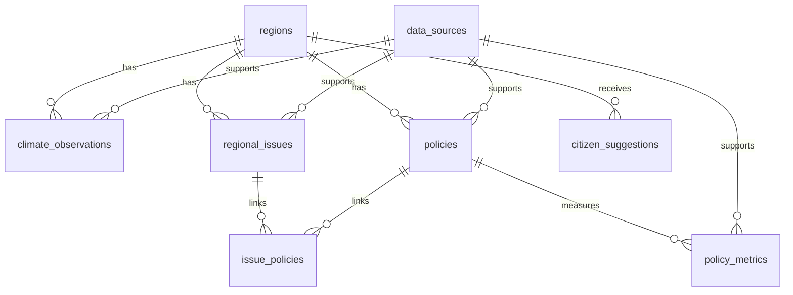

# 우리동네 기후·정책 (Local Climate Policy)

지역의 기후변화 지표, 생활권 문제, 지방자치단체 정책을 한곳에서 확인하고 정책 관련 지표를 비교하기 위한 웹 애플리케이션입니다. 현재 저장소에는 HTML/CSS/JavaScript 프런트엔드와 FastAPI 백엔드 골격, MySQL 스키마가 포함되어 있습니다.

> **데이터 주의:** 현재 프런트엔드의 기후 수치, 지도 마커, 정책 카드 및 정책 효과 값은 화면 시연용 예시입니다. 실제 관측값·위험도·정책 현황·정책 성과로 인용하지 마세요. 공식 자료 연동과 검증은 별도 구현·확인이 필요합니다.

## 1. 기능정의서

| ID | 기능 | 주요 입력·처리 | 결과 및 검수 기준 |
|---|---|---|---|
| F-01 | 메인 대시보드 | 지역 선택, 기후·문제·정책 요약 조회 | 지역별 요약과 화면 이동 제공 |
| F-02 | 지역 기후 분석 | 지역, 기후 지표, 기간 선택 | 연도별 그래프 표시; 단위·기간·출처 확인 |
| F-03 | 지역문제 지도 | 문제 유형 필터, 지도 마커 선택 | 문제 위치와 상세 화면 연결; 위치는 공식 자료로 검증 |
| F-04 | 지역문제 상세 | 문제 설명, 지표, 자료 출처 확인 | 확인된 사실과 분석 가설 구분 |
| F-05 | 지역정책 탐색 | 정책 키워드, 분야, 지역 검색 | 담당기관·기간·상태·공식 URL 확인 |
| F-06 | 정책 효과 비교 | 정책, 지표, 시행 전후 기간 선택 | 비교값·단위·기간 표시; 차이만으로 인과효과를 단정하지 않음 |
| F-07 | 시민참여 | 지역, 유형, 장소, 제안 내용 입력 | 입력값 검증 및 접수 상태 표시; 공개 전 개인정보 검토 |
| F-08 | 데이터 출처·품질 관리 | 출처 URL, 수집일, 단위, 기준일, 검증 상태 관리 | 원자료 추적과 미검증 자료 식별 |
| F-09 | API 제공 | FastAPI 엔드포인트 요청 | 프런트엔드용 JSON 응답 |
| F-10 | AI 기사 초안 | 주제, 지역, Fact Sheet, 원자료 URL | `/api/news/draft`로 OpenAI 초안 생성; 자동 게시하지 않고 원자료 대조·사람 승인 필요 |

### 업무·검증 원칙
- 출처·기준일·단위가 확인되지 않은 값은 검증 완료 자료처럼 표시하지 않습니다.
- 결측값을 0으로 대체하지 않고, 누락·중복·이상값을 별도로 표시합니다.
- 서로 다른 지역 단위·관측 지점·기간의 자료를 직접 비교하지 않습니다.
- 정책 전후 차이는 참고 지표이며, 다른 요인을 검토하지 않고 정책의 인과적 효과라고 단정하지 않습니다.
- 시민 제안은 필요한 정보만 수집하고, 공개 전 개인정보와 게시 적합성을 확인합니다.

## 2. 화면구성도·화면설계

### 화면 흐름

```text
메인 대시보드
├── 지역 기후 분석
│   └── 지역·지표·기간 선택 → 그래프·출처 확인
├── 지역문제 지도
│   └── 문제 유형 선택 → 문제 상세 → 관련 정책
├── 지역정책 탐색
│   └── 키워드·분야·지역 필터 → 정책 정보
├── 정책 효과 비교
│   └── 정책·지표 선택 → 시행 전후 값 비교
└── 시민참여
    └── 제안 입력 → 검증 → 접수 상태
```

### 화면별 설계

| 화면 | 주요 구성 요소 | 사용자 동작 | 확인 사항 |
|---|---|---|---|
| 1. 홈 | 지역 선택, 기후 요약, 주요 이슈, 정책 카드 | 각 기능으로 이동 | 요약 데이터의 기준일·출처 |
| 2. 지역 기후 | 지역·지표·기간 필터, 그래프, 출처 링크 | 조건 변경 및 추이 확인 | 단위, 기간, 관측소, 결측치 |
| 3. 지역문제 지도 | 지도, 문제 유형 필터, 문제 목록 | 마커·목록 선택 | 좌표와 위험 정보의 공식 출처 |
| 4. 문제 상세 | 현황, 관련 지표, 근거 자료, 관련 정책 | 근거 및 정책 확인 | 사실과 가설 구분 |
| 5. 지역정책 | 검색, 분야·지역 필터, 정책 카드 | 정책 탐색 | 담당기관, 시행 상태, 공식 URL |
| 6. 정책 효과 비교 | 정책·지표 선택, 전후 값·기간 | 비교 결과 확인 | 단위와 비교 기간 일치 여부 |
| 7. 시민참여 | 지역·유형·장소·내용 입력, 공개 여부 | 제안 제출 | 필수값·개인정보·공개 승인 |\n| 8. AI 기사 제작 | 주제·독자·형식, Fact Sheet, 원자료 URL, 초안·검수 체크리스트 | 초안 생성, 원자료 대조, 사람 검수·승인 상태 관리 | AI 초안과 실제 게시를 구분; 현재 임시 저장은 브라우저 로컬에만 보관 |

공통 UI 원칙: 로딩·오류·빈 결과·검증 대기 상태를 구분하고, 데이터 화면에서 출처와 기준일을 쉽게 확인할 수 있도록 합니다. 좁은 화면에서도 사용할 수 있도록 반응형 레이아웃을 유지합니다.

## 3. DB 설계

- **DBMS:** MySQL
- **데이터베이스:** `local_climate_policy`
- **스키마 파일:** `database/schema.sql`
- **PK:** 각 테이블 레코드의 고유 식별자
- **FK:** 지역·출처·문제·정책 간 관계를 연결

### ERD 개요



### 테이블 정의

| 테이블 | PK | 주요 컬럼·관계 | 목적 |
|---|---|---|---|
| `regions` | `region_id` | `region_code`, `parent_region_id`, `region_name`, `region_level` | 지역 및 상하위 지역 구조 |
| `data_sources` | `source_id` | `source_name`, `source_url`, `license_note`, `checked_at` | 원자료 출처·이용 조건 관리 |
| `climate_observations` | `observation_id` | `region_id` FK, `source_id` FK, `station_code`, `metric_code`, `observation_date`, `metric_value`, `unit`, `quality_flag` | 기후 관측값 |
| `regional_issues` | `issue_id` | `region_id` FK, `source_id` FK, 제목·유형·기준일·좌표·검증 상태 | 지역문제 정보 |
| `policies` | `policy_id` | `region_id` FK, `source_id` FK, 정책명·담당기관·상태·기간·예산·공식 URL | 지역정책 정보 |
| `issue_policies` | `issue_id` + `policy_id` | 두 컬럼 모두 FK | 문제와 정책의 다대다 관계 |
| `policy_metrics` | `policy_metric_id` | `policy_id` FK, `source_id` FK, 지표명·전후 값·단위·비교 기간 | 정책 관련 지표 비교 |
| `citizen_suggestions` | `suggestion_id` | `region_id` FK, 유형·장소·내용·상태·공개 여부 | 시민 제안 접수·관리 |

### 주요 제약조건
- `regions.region_code`는 중복 방지를 위해 UNIQUE로 관리합니다.
- 관측 자료는 지역·지표·날짜 조합을 고려해 조회 인덱스를 설정합니다.
- `issue_policies`는 두 FK를 복합 PK로 사용해 같은 관계의 중복 등록을 막습니다.
- 관측값·정책 지표에는 단위와 기준 기간을 함께 저장합니다.
- 실제 운영 전 날짜 범위, 허용 상태값, 입력값, 권한 및 개인정보 처리 규칙을 추가 검증합니다.

## 4. 데이터 수집 방법

자료는 공식 출처를 우선으로 하며, CSV 다운로드·Open API·PDF 문서 방식으로 수집할 수 있습니다.

| 방식 | 대상 예시 | 수집 절차 | 유의 사항 |
|---|---|---|---|
| CSV 다운로드 | 기온·강수량·폭염일수·지역 통계 | 공식 사이트에서 다운로드 → Python으로 읽기 → 정제·저장 | 인코딩, 날짜 형식, 결측치, 단위 확인 |
| Open API | 기상 관측·공공데이터·지역 통계 | 이용 신청 및 인증키 발급 → HTTP 요청 → JSON 파싱 → 정제·저장 | 인증키 보호, 호출 한도, 오류 응답 확인 |
| PDF 문서 | 지자체 기후계획·정책 보고서·사업계획 | 공식 PDF 확보 → 텍스트·표 추출 → 원문 페이지와 대조 | 표 추출 오류와 문맥 누락을 원문으로 검증 |

### 권장 공식 출처
- 기상자료개방포털: https://data.kma.go.kr/
- 공공데이터포털: https://www.data.go.kr/
- 국가통계포털(KOSIS): https://kosis.kr/
- 지자체 공식 홈페이지, 기후대응계획, 정책 공고 및 사업계획서

### 수집 및 검증 절차
1. 출처의 공식성, 이용 조건, 갱신 주기와 API 호출 조건을 확인합니다.
2. 원본 URL·수집 일시·자료 기준일을 기록합니다.
3. Python으로 지역 코드, 날짜, 단위, 결측·중복값을 정리합니다.
4. 원자료와 대조하고 검증 상태를 표시합니다.
5. 검증된 자료만 분석·화면 표시·기사 초안 작성에 사용합니다.

### AI 기사 작성 시 근거 확인
```text
주제 선정
 → CSV / Open API / PDF 원자료 수집
 → Fact Sheet(핵심 사실·수치·출처) 검증
 → OpenAI API로 기사 초안 생성
 → 주장·수치를 원자료와 대조하고 수정
 → 사람의 최종 검토·승인
 → 게시
```

LLM이 만든 문장을 사실로 간주하지 않습니다. 원자료로 확인할 수 없는 주장은 삭제하거나 미확인으로 표시하며, 자동 게시 대신 사람의 최종 승인을 거칩니다.

## 5. 개발 환경

| 항목 | 기술 | 용도 |
|---|---|---|
| 운영체제 | Windows 11 | 로컬 개발 |
| 개발 도구 | Visual Studio Code | 코드 편집·터미널·디버깅 |
| 언어 | Python | 데이터 수집·정제·검증 및 백엔드 |
| 백엔드 | FastAPI, Uvicorn | REST API 제공 |
| 데이터베이스 | MySQL | 기후·지역문제·정책·출처·시민 제안 저장 |
| LLM | OpenAI API | 근거 자료 기반 뉴스 기사 초안 생성 |
| 프런트엔드 | HTML, CSS, JavaScript | 사용자 화면과 상호작용 |
| 시각화·지도 | Chart.js, Leaflet | 그래프 및 지도 표시 |
| 설정 관리 | `.env` | API 키와 DB 접속 정보 관리 |

현재 프런트엔드는 HTML/CSS/JavaScript 기반이며, FastAPI에는 입력된 Fact Sheet를 바탕으로 OpenAI 기사 초안을 만드는 `/api/news/draft` 엔드포인트가 있습니다. 다만 공식 원자료 URL을 자동으로 열어 본문을 검증하지 않으며, 기사 생성 결과는 초안입니다. 기후·정책 데이터의 실제 DB 조회, 시민 제안 DB 저장, 기사·검수 이력의 서버 저장 및 실제 게시 기능은 아직 완성되지 않았습니다.

### 환경변수 예시

```dotenv
OPENAI_API_KEY=발급받은_API_키
OPENAI_MODEL=gpt-4.1-mini
DB_HOST=127.0.0.1
DB_PORT=3306
DB_NAME=local_climate_policy
DB_USER=사용자명
DB_PASSWORD=비밀번호
```

실제 변수명은 백엔드 구현과 일치시켜야 합니다. `.env`는 GitHub에 올리지 말고, `.env.example`에는 비밀값이 아닌 변수명과 예시만 기록합니다. 사용 가능한 OpenAI 모델명과 계정 접근 권한은 실행 시점의 API 문서에서 확인합니다.

## 6. 실행 방법

### 준비
- Git과 VS Code 설치
- Python 3.12 권장(설치된 버전은 `py --list`로 확인)
- MySQL Server 설치 및 실행
- 선택 기능 사용 시 OpenAI API 키 준비

### 6.1 저장소 내려받기

VS Code 터미널 또는 PowerShell에서 실행합니다.

```powershell
git clone https://github.com/sinyoungk0711-droid/local-climate-policy.git
cd local-climate-policy
code .
```

### 6.2 프런트엔드 실행

1. VS Code에서 `frontend/index.html`을 엽니다.
2. Live Server 확장으로 실행하거나 브라우저에서 파일을 엽니다.
3. 지도 타일과 외부 JavaScript 라이브러리를 사용하므로 인터넷 연결이 필요할 수 있습니다.

### 6.3 FastAPI 실행

프로젝트 루트에서 실행합니다.

```powershell
py -3.12 -m venv .venv
.\.venv\Scripts\Activate.ps1
python -m pip install --upgrade pip
pip install -r backend/requirements.txt
uvicorn backend.app.main:app --reload
```

- API 서버: http://127.0.0.1:8000
- API 문서: http://127.0.0.1:8000/docs
- 종료: 터미널에서 `Ctrl+C`

Python 3.12가 설치되어 있지 않으면 `py --list`로 사용 가능한 버전을 확인하고 호환되는 버전을 사용합니다. PowerShell에서 가상환경 활성화가 제한되면 터미널 정책을 확인하거나 명령 프롬프트에서 `.venv\Scripts\activate.bat`를 실행합니다.

### 6.4 MySQL 설정

1. MySQL 서버를 실행합니다.
2. MySQL 클라이언트에서 `database/schema.sql`을 실행합니다.
3. `.env.example`을 참고해 프로젝트 루트에 `.env`를 만듭니다.
4. DB 접속 정보가 실제 백엔드 코드에서 읽히는지 확인합니다.

스키마 실행은 테이블 생성 단계이며, API가 MySQL에 자동으로 연결되거나 데이터가 자동 수집된다는 뜻은 아닙니다. DB 연결 및 CRUD 기능은 코드 구현 상태를 확인해야 합니다.

### 6.5 OpenAI API 설정

1. OpenAI 플랫폼에서 API 키를 발급하고 계정의 사용량·결제 설정을 확인합니다.
2. `.env`에 `OPENAI_API_KEY`와 사용할 모델명을 설정합니다.
3. 백엔드에서 환경변수를 읽고 API 호출을 수행하도록 구현·테스트합니다.
4. 기사 초안은 원자료와 대조하고 사람의 승인을 받은 뒤 사용합니다.

### 실행 점검
- 프런트엔드가 표시되지 않으면 파일 경로와 Live Server 주소를 확인합니다.
- FastAPI 오류는 가상환경, 의존성 설치, 터미널 오류 메시지를 확인합니다.
- `/docs`가 열리지 않으면 서버 실행 여부와 포트 충돌을 확인합니다.
- MySQL 오류는 서버 상태, 계정 권한, 포트, DB 이름과 환경변수를 확인합니다.
- 지도·외부 라이브러리는 인터넷 연결 상태를 확인합니다.
- 실제 운영 전에는 인증·권한·입력 검증·오류 처리·로그·개인정보 보호를 추가 점검합니다.

## 프로젝트 구조

```text
local-climate-policy/
├── frontend/
│   ├── index.html
│   ├── css/styles.css
│   └── js/app.js
├── backend/
│   ├── app/main.py
│   └── requirements.txt
├── database/
│   └── schema.sql
├── .env.example
└── README.md
```

## 개발 상태 및 다음 단계

1. 공식 기후·지역 통계·정책 자료원을 확정합니다.
2. CSV/API/PDF 수집과 출처·기준일 기록을 구현합니다.
3. MySQL 연결 및 데이터 검증·조회 API를 테스트합니다.
4. 프런트엔드를 실제 API 데이터와 연결합니다.
5. Fact Sheet 검증, OpenAI 기사 초안 생성, 원자료 대조, 사람 검수 절차를 구현합니다.
6. 보안·개인정보·데이터 품질 점검 후 공개 범위를 결정합니다.
