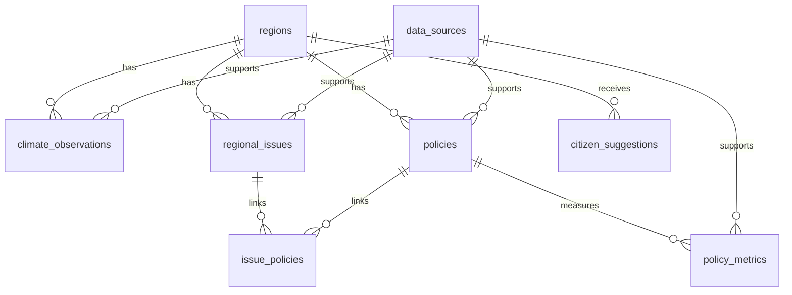

# 우리동네 기후·정책 — 실행 가능한 프로토타입

지역기후·지역문제·지역정책을 연결하는 7개 화면 웹서비스의 초급자용 프로젝트입니다.

## 포함된 기능
- 7개 화면: 메인, 지역 기후, 지역문제 지도, 문제 상세, 지역정책, 정책 효과 비교, 시민참여
- 지역 선택과 기후 지표 선택
- Chart.js 기반 그래프
- Leaflet 기반 인터랙티브 지도(인터넷 연결 필요)
- 정책 검색 및 분류 필터
- 정책 전후 지표 비교
- 시민 제안 폼 입력 검증
- FastAPI API 골격
- MySQL용 `database/schema.sql`

## 데이터 주의
프론트엔드에 포함된 값은 **화면 기능 확인용 예시 데이터**입니다. 실제 관측값, 공식 정책 현황, 정책 효과로 인용하거나 게시하지 마세요. 실제 운영 전 기상청·KOSIS·공공데이터포털 및 지자체 공식 자료로 교체하고 출처·기준일·단위를 검수해야 합니다.

## 1. 프론트엔드 실행 (가장 쉬운 방법)
1. ZIP 압축을 풉니다.
2. `frontend/index.html` 파일을 브라우저에서 엽니다.
3. 지도 타일과 Chart.js를 사용하므로 인터넷 연결이 필요합니다.

권장 방법은 VS Code에서 프로젝트 폴더를 열고 Live Server 확장으로 `frontend/index.html`을 실행하는 것입니다.

## 2. FastAPI 실행
Windows 11 PowerShell에서 프로젝트 루트로 이동합니다.

```powershell
py -3.12 -m venv .venv
.\\.venv\\Scripts\\Activate.ps1
python -m pip install --upgrade pip
pip install -r backend/requirements.txt
uvicorn backend.app.main:app --reload
```

API 문서는 `http://127.0.0.1:8000/docs` 에서 확인할 수 있습니다.

Python 3.12가 없다면 `py --list`로 설치된 버전을 확인하고, 호환되는 Python 버전을 사용하세요.

## 3. MySQL 설정
1. MySQL에서 `database/schema.sql`을 실행합니다.
2. 프로젝트 루트의 `.env.example`을 `.env`로 복사합니다.
3. `.env`에 DB 접속 정보를 입력합니다.
4. API 코드의 DB 연결은 기본 예시이며, 실제 DB 연결 및 CRUD 기능은 다음 개발 단계에서 구현해야 합니다.

현재 API는 `/api/health`, `/api/regions`, `/api/climate`, `/api/issues`, `/api/policies` 등 기본 엔드포인트의 동작 예시를 제공합니다. 데이터베이스 연결 및 공식 API 연동은 아직 연결되지 않은 골격입니다.

## 폴더 구조
```text
local-climate-policy/
├── frontend/
│   ├── index.html
│   ├── css/styles.css
│   └── js/app.js
├── backend/
│   ├── app/main.py
│   └── requirements.txt
├── database/schema.sql
├── .env.example
└── README.md
```

## 4. 기능정의서

### 4.1 목적과 범위
지역별 기후 지표, 지역 문제, 지자체 정책 정보를 한곳에서 확인하고, 정책 전후 지표를 비교할 수 있는 프로토타입입니다. 데이터의 출처와 검증 상태를 함께 관리해 예시 데이터가 실제 사실로 오인되는 것을 방지합니다.

### 4.2 기능 목록

| ID | 기능 | 입력·처리 | 결과 및 검수 기준 |
|---|---|---|---|
| F-01 | 메인 대시보드 | 지역별 주요 기후·문제·정책 요약 | 선택한 지역과 요약 정보 표시 |
| F-02 | 지역·기후 조회 | 지역, 지표, 날짜 범위 선택 | 기후 데이터와 그래프 표시 |
| F-03 | 지역문제 지도 | 문제 유형 및 지역 정보 조회 | 지도 위치와 문제 상세 연결 |
| F-04 | 문제 상세 | 문제 설명, 기준일, 출처 확인 | 출처와 검증 상태 표시 |
| F-05 | 정책 검색 | 정책명, 지역, 상태 필터 | 정책 정보와 공식 링크 표시 |
| F-06 | 정책 효과 비교 | 정책별 전·후 값과 기간 선택 | 단위·기간이 명시된 비교 결과 |
| F-07 | 시민 제안 | 지역, 유형, 장소 설명, 제안 내용 입력 | 필수값 검증 후 접수 상태 표시 |
| F-08 | 자료 출처 관리 | 자료원 이름, URL, 이용 조건 등록 | 출처와 확인 시각 기록 |
| F-09 | 데이터 검증 | 누락·중복·단위·기간 및 공식 출처 확인 | 미검증 데이터 표시 및 수정 대상 분류 |
| F-10 | API 제공 | FastAPI 엔드포인트로 데이터 응답 | 프런트엔드가 사용할 JSON 응답 |
| F-11 | 운영·개인정보 보호 | 제안 공개 여부와 상태 관리 | 공개 동의 전 비공개, 최소한의 정보 수집 |

### 4.3 업무 규칙
- 출처가 없거나 검증되지 않은 기후·정책 정보는 검증 완료 자료처럼 표시하지 않습니다.
- 정책의 전후 수치 차이는 그 자체로 정책의 인과적 효과를 입증하지 않습니다. 비교 기간, 단위, 다른 영향 요인을 함께 검토해야 합니다.
- 지역 코드와 관측 지점 코드를 구분하고, 집계 단위가 다른 데이터를 직접 비교하지 않습니다.
- 시민 제안은 기본 비공개로 처리하고, 공개 전 개인정보 및 게시 적합성을 확인합니다.
- 실제 서비스 전에는 API와 DB의 인증·권한 검사, 입력값 검증, 오류 처리 및 로그를 구현합니다.

## 5. 화면구성도·화면설계

### 5.1 전체 화면 구조

```text
메인 대시보드
├── 지역 기후
│   ├── 지역 선택
│   ├── 기후 지표·기간 선택
│   └── 그래프 및 자료 출처
├── 지역문제 지도
│   └── 문제 상세
├── 지역정책
│   └── 정책 상세 및 공식 출처
├── 정책 효과 비교
│   └── 전·후 값·기간·단위 비교
└── 시민참여
    └── 제안 입력·검증·접수 상태
```

### 5.2 화면별 설계

| 화면 | 주요 구성 요소 | 사용자 동작 | 검수 사항 |
|---|---|---|---|
| 1. 메인 | 지역 요약, 주요 기후 지표, 문제·정책 요약 | 지역 화면으로 이동 | 요약값의 기준일과 출처 |
| 2. 지역 기후 | 지역 선택, 지표 선택, 기간 필터, Chart.js 그래프 | 조건 변경 및 추세 확인 | 단위, 기간, 결측치, 관측 지점 |
| 3. 지역문제 지도 | Leaflet 지도, 문제 유형 필터, 목록 | 지도 마커 선택 | 좌표 정확성, 문제 정보 출처 |
| 4. 문제 상세 | 제목, 설명, 기준일, 출처, 검증 상태 | 관련 정책 확인 | 사실과 해석 구분 |
| 5. 지역정책 | 정책 검색, 지역·상태 필터, 담당 기관, 공식 URL | 정책 상세 확인 | 정책 시행 상태와 날짜 |
| 6. 정책 효과 비교 | 정책 선택, 전·후 값, 기간, 단위, 비교 그래프 | 지표 비교 | 비교 기간의 적절성, 인과관계 과장 방지 |
| 7. 시민참여 | 지역·분류·장소·내용 입력, 공개 여부 | 제안 제출 | 필수값, 개인정보, 스팸 및 공개 승인 |

### 5.3 공통 UI·상태 규칙
- 모든 데이터 화면에서 출처와 기준일을 확인할 수 있어야 합니다.
- 데이터가 없을 때는 0으로 대체하지 말고 ‘자료 없음’ 또는 ‘미수집’으로 표시합니다.
- 로딩 중, 오류, 빈 결과, 검증 대기 상태를 구분합니다.
- 지도·그래프는 장식이 아니라 선택한 지역·기간·지표에 맞춰 갱신되어야 합니다.
- 모바일 또는 좁은 화면에서도 표와 입력 폼을 사용할 수 있도록 반응형 레이아웃을 적용합니다.

## 6. DB 설계

### 6.1 설계 원칙
MySQL 데이터베이스 이름은 `local_climate_policy`이며, 실제 테이블과 컬럼 정의는 `database/schema.sql`을 기준으로 합니다. PK는 각 레코드의 고유 식별자이고, FK는 테이블 사이의 관계를 보장합니다. 주요 관계는 아래와 같습니다.

### 6.2 ERD 개요



### 6.3 테이블 정의

| 테이블 | PK | 주요 컬럼 | 관계·용도 |
|---|---|---|---|
| `regions` | `region_id` | `region_code`, `parent_region_id`, `region_name`, `region_level` | 지역 계층 구조. `region_code`는 UNIQUE |
| `data_sources` | `source_id` | `source_name`, `source_url`, `license_note`, `checked_at` | 데이터 출처 및 이용 조건 |
| `climate_observations` | `observation_id` | `region_id`, `source_id`, `station_code`, `metric_code`, `observation_date`, `metric_value`, `unit`, `quality_flag` | 지역별 기후 관측값 |
| `regional_issues` | `issue_id` | `region_id`, `source_id`, `issue_title`, `issue_category`, `reference_date`, 좌표, `verification_status` | 지역 문제 및 위치·검증 정보 |
| `policies` | `policy_id` | `region_id`, `source_id`, `policy_title`, `responsible_agency`, `status`, 시행 기간, 예산, `official_url` | 지역 정책 정보 |
| `issue_policies` | `issue_id` + `policy_id` | `relationship_note` | 지역 문제와 정책의 다대다 연결 |
| `policy_metrics` | `policy_metric_id` | `policy_id`, `source_id`, `metric_name`, 전·후 값, 단위, 전·후 기간, `calculation_note` | 정책 관련 지표 비교 |
| `citizen_suggestions` | `suggestion_id` | `region_id`, `category`, `place_description`, `description`, `status`, `is_public` | 시민 제안 및 처리 상태 |

### 6.4 외래키(FK) 관계
- `regions.parent_region_id` → `regions.region_id`: 상위 지역과 하위 지역 연결
- `climate_observations.region_id` → `regions.region_id`
- `climate_observations.source_id` → `data_sources.source_id`
- `regional_issues.region_id` → `regions.region_id`
- `regional_issues.source_id` → `data_sources.source_id`
- `policies.region_id` → `regions.region_id`
- `policies.source_id` → `data_sources.source_id`
- `issue_policies.issue_id` → `regional_issues.issue_id`
- `issue_policies.policy_id` → `policies.policy_id`
- `policy_metrics.policy_id` → `policies.policy_id`
- `policy_metrics.source_id` → `data_sources.source_id`
- `citizen_suggestions.region_id` → `regions.region_id`

### 6.5 주요 제약조건 및 인덱스
- 지역 코드에 UNIQUE 제약조건을 적용해 동일 코드의 중복 등록을 막습니다.
- 관측 데이터는 지역·지표·날짜 복합 인덱스로 조회 효율을 높입니다.
- 지역 문제와 정책 연결 테이블은 두 FK를 복합 PK로 사용해 동일 연결이 중복되지 않게 합니다.
- 정책 전후 값은 단위와 전·후 기간을 함께 저장합니다. 비교 기간이 다르면 직접 비교에 주의해야 합니다.
- 관측값의 품질 상태와 문제·정책의 검증 상태를 보존해 미검증 데이터가 검증된 정보로 오인되지 않도록 합니다.
- 실제 운영에서는 정책 상태 등 문자열 컬럼의 허용값을 애플리케이션 검증 또는 DB 제약조건으로 제한하고, 날짜 범위 및 값의 유효성을 검사합니다.

### 6.6 데이터 흐름

```text
공식 자료 수집
  → data_sources에 출처 등록
  → climate_observations / regional_issues / policies 저장
  → 출처·기간·단위·상태 검증
  → 화면에서 지도·그래프·정책 비교 표시
  → 시민 제안은 citizen_suggestions에 별도 저장
```

현재 `schema.sql`은 데이터 구조와 관계를 정의하지만, 실제 운영 데이터의 자동 수집·검증 및 모든 CRUD 처리가 완성되었다는 의미는 아닙니다.

## 7. 데이터 출처 및 검증 원칙
- 기상청 기상자료개방포털: https://data.kma.go.kr/
- 공공데이터포털: https://www.data.go.kr/
- 국가통계포털(KOSIS): https://kosis.kr/
- 각 지자체 공식 홈페이지 및 공개 정책 자료

수집 전에 자료의 이용 조건, 갱신 주기, API 인증 및 호출 한도를 확인합니다. 기사나 보고서에 사용할 수치는 원자료와 대조하고, 기준 기간·지역·단위·출처를 함께 기록합니다.

## 실제 서비스 전 점검
- 공식 데이터의 이용 조건과 API 호출 한도
- 지역 코드와 관측 지점의 매핑
- 데이터 누락·중복·단위·기준 기간
- 정책 계획/시행/완료 상태 검증
- 정책 전후 비교에서 인과관계를 과장하지 않는지
- 시민 제안 개인정보 및 파일 업로드 보안
- API 키·DB 비밀번호를 GitHub에 올리지 않는지
